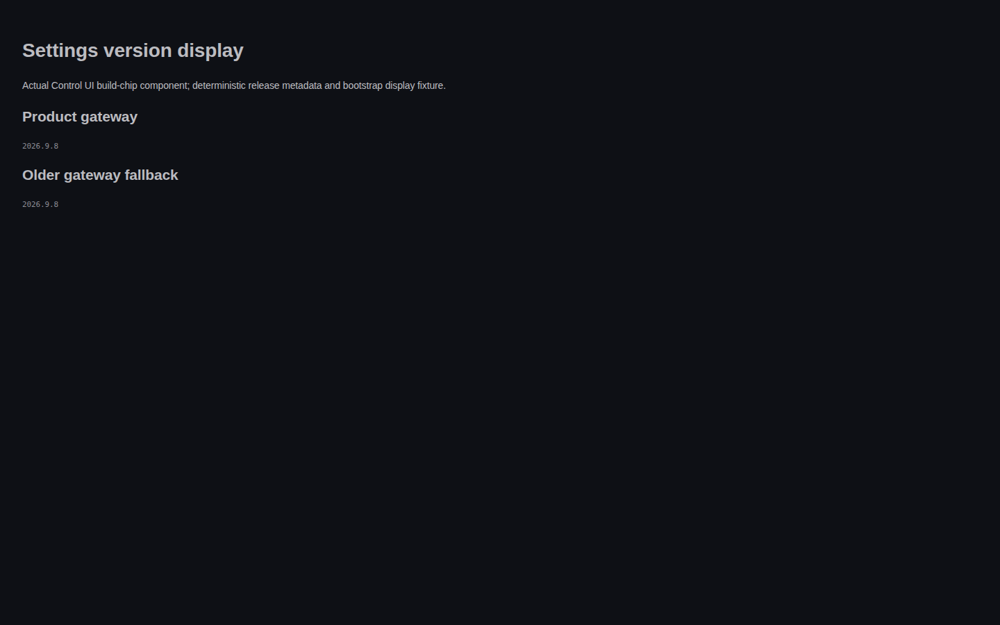
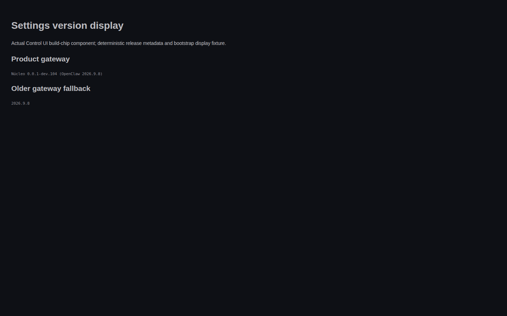
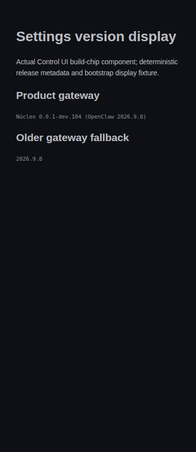

# Control UI product-version proof

Actual Control UI build-chip component, real Chromium 153.0.8010.12, Linux, headless, behind a quiet-host gate. No running service, account or desktop was used.

## Before and after

| Fixture                                             | Before   | After                                    |
| --------------------------------------------------- | -------- | ---------------------------------------- |
| Product gateway with bundled compatibility metadata | 2026.9.8 | Núcleo 0.0.1-dev.104 (OpenClaw 2026.9.8) |
| Older gateway without product display               | 2026.9.8 | 2026.9.8                                 |

Before source: 8790ffbc0db030a3382b7d454bcb808ab662af79. After source: d69d78af3d9fdba987e534fb3a3776bd736c04dd. Both captures have zero browser page errors. Dimensions: 1440x900, 820x900 and 390x900. These are actual component captures with deterministic artifact metadata and a bootstrap-shaped display fixture, not a deployed gateway or full application screenshot.





## Behavioral reproduction

The new formatSettingsBuildLabel regression on unchanged source returned 2026.7.10 instead of the product display: 1 failed, 19 passed. After the fix, the four focused UI files pass 80 tests. They include actual Settings sidebar rendering, shell navigation projection, normalization and clearing stale product display after reconnect to an older gateway. The Gateway presentation suite passes four tests. Lint reports zero warnings/errors on eleven downstream TypeScript files.

The product display now travels on its own property all the way to the chip; gatewayVersion remains the compatibility version. Existing artifact-first behavior is unchanged when productVersion is absent.

## Reproduce rendered evidence

From the repository root, set BROWSER_ENGINE_MODULE to the shared browser-engine scripts/lib/browser.mjs module and PROOF_OUT to an output directory. Install the repository dependencies and the shared engine's Chromium runtime, then run:

```sh
PROOF_REVISION=$(git rev-parse HEAD) node distro/docs/proof/control-ui-version/render.mjs after
pnpm exec vitest run --config ui/vitest.config.ts ui/src/components/sidebar-build-chip.node.test.ts ui/src/app/config.test.ts ui/src/app/app-host.document-title.test.ts ui/src/components/settings-sidebar.test.ts --maxWorkers=1
```

The same harness in before mode against the before revision produces the baseline. The harness binds only loopback on an ephemeral port, closes its server/browser in finally, and checks both rendered labels before accepting the run. It deliberately supplies non-null bundled metadata so a fallback-only patch cannot pass.

## Remaining PR129 purposes

- Resolver fallback: preserved by merged #134.
- Control UI bootstrap/client/rendering: carried by #138; this proof does not merge it.
- Provider attribution: current dual-version contract measured with OPENCLAW_VERSION 2026.9.8 and NUCLEO_VERSION 0.0.1-dev.104 emits version header 2026.9.8 and User-Agent openclaw/2026.9.8. This satisfies the intent of #96 without reviving the obsolete compatibility-host override. It is a local policy probe, not an authenticated provider call.
- Shutdown cancellation order and short stop ceiling: not covered by current main; isolated in #140 with measured 320000ms stop drain and source-order evidence. No live stop performed.
- Build metadata production for env-free product fallback: not established by resolver fixtures; isolated in #141. No image build or rollout claimed.

Do not close #129 merely because #138 exists. The parent controller owns serial merging and eventual supersession decisions; #140 and #141 remain separate open acceptance.
